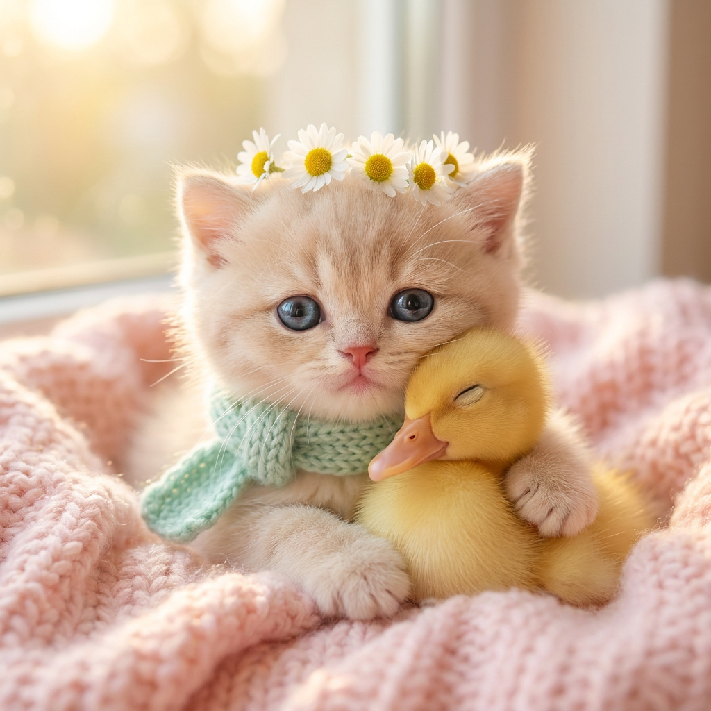

# Cutest Picture

An entry for the make.fun bounty "Make the cutest picture" (`cutest-picture-01`).

`main.py` copies `assets/entry.png` byte for byte to `/output/entry.png`. It checks that the picture is a PNG or JPEG of at most 1 MiB before writing, so every run produces the same bytes. It also reads the width and height from the PNG IHDR chunk or the JPEG SOF0, SOF1 or SOF2 marker and refuses anything wider or taller than 1024 pixels. It uses only the Python standard library and needs no network.

## Run

```sh
python main.py
```

For local testing, set `OUTPUT_DIR` to write somewhere other than `/output`:

```sh
OUTPUT_DIR=./out python main.py
```

## Picture

### Kitten hugging a sleepy duckling

A fluffy ginger-and-cream kitten with big blue eyes, a mint knitted scarf and a daisy crown hugs a sleepy yellow duckling wrapped in a pink knitted blanket.

The picture was generated once with FLUX.1-schnell and checked into the repository. The program only copies it, with no network and no randomness, so both runs write the same bytes. The file holds JPEG data stored under the `entry.png` name.



## License

MIT, see [LICENSE](LICENSE).
